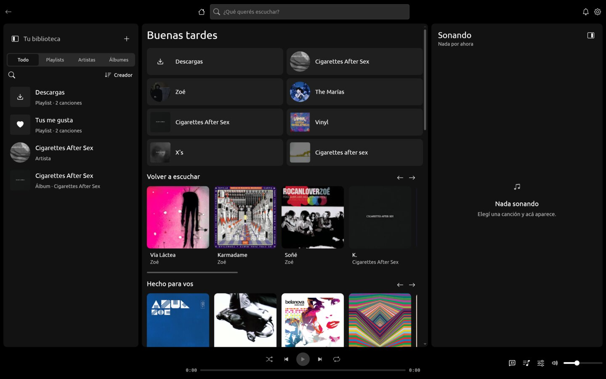
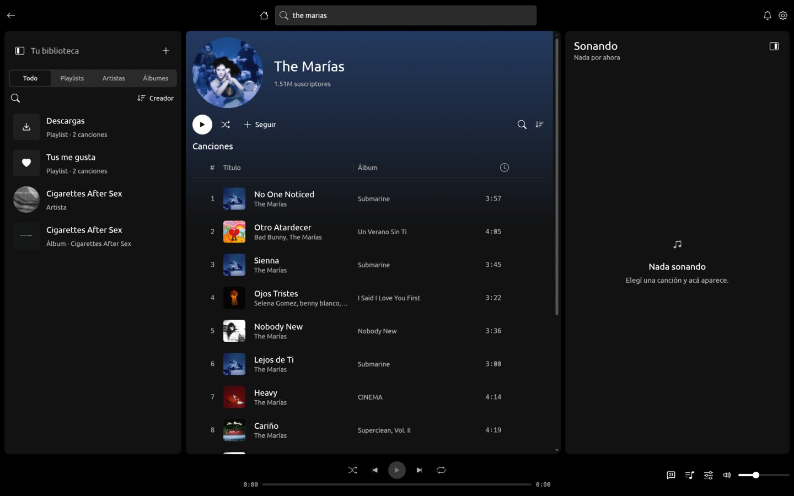
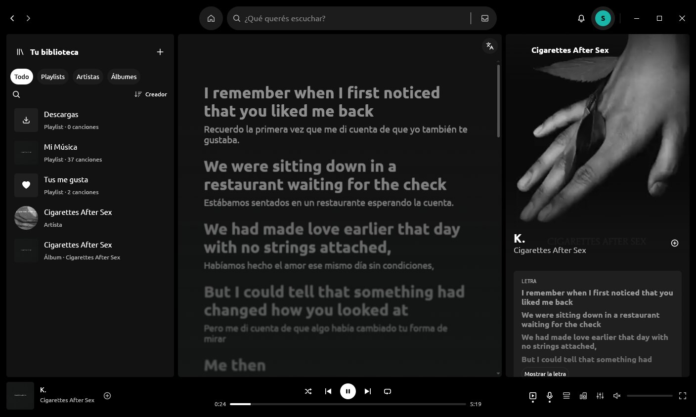

# Surco

A native music player for the desktop, written entirely in Rust. The interface is drawn
with [limn](https://github.com/Niiihuel/limn); there is no web view. *Surco* is the
groove of a record: where the needle travels.



It plays without an account. What is liked, kept and listed stays on the machine that
plays it; a playlist is shared as a link that carries it whole.

## What it does

- Search, artist and album pages, and a home page of picks made from what is played.
- Gapless playback with crossfade, a ten-band equaliser, even loudness and a choice of
  output device and quality.
- Synced lyrics, the song's own video beside it or over the whole window, the queue,
  shuffle with the catalog's picks woven in.
- A library that searches, sorts, pins and lists as lines, rows or tiles; local
  playlists, likes and downloads for listening without a network.
- Import public Spotify, YouTube Music and Apple Music playlists or albums by pasting
  their links in the search bar, or from the library and settings. Export a playlist
  as artist-and-title text to paste into a playlist transfer service. Spotify imports
  read up to 100 tracks; songs that cannot be matched are reported after the import.
- A bell for what the artists followed release, and for later versions of the app.

| | |
|---|---|
|  |  |

## Crates

| Crate | What it is |
|---|---|
| `crates/app` | The window: state, views and the worker that talks to the network and the engine. |
| `crates/core` | `Track`, the play queue, lyrics and the picks of the home page. No I/O. |
| `crates/youtube` | YouTube Music as a catalog and as a source of audio and video streams. |
| `crates/audio` | Decode, two-deck output with gapless and crossfade, equaliser. |
| `crates/video` | Reads a fragmented MP4 and decodes its H.264 pictures. |

## Build

limn is used by path and must sit next to this repository as `../lienzo`.

```sh
cargo run -p surco
cargo test --workspace
```

On NixOS, through the shell that brings the system libraries:

```sh
nix-shell shell.nix --run "cargo run -p surco"
```

On other Linux systems the build needs the development packages of ALSA, and at run time
Wayland or X11 with libxkbcommon. `--search <text>`, `--play <n>` and
`--screenshot <file.png> --after <ms>` drive the window from the command line, for
checking a build without touching it.

## iOS

The iOS target keeps the engine and interface in Rust with limn. `cargo run -p surco -- --mobile`
previews the phone layout on a desktop. The **iOS** GitHub Actions workflow builds an
iPhone simulator app and an unsigned device app; the simulator run saves a screenshot.
Installing on an iPhone requires Apple signing and provisioning. See [the iOS build and
validation notes](docs/ios.md) for commands, artifacts and the remaining hardware checks.

## Releases

A tag `v1.2.3` that matches the version in `Cargo.toml` builds Linux, Windows and macOS
and publishes them together. A running app finds the release, fetches the program of its
system, checks it against the release's sums and puts it in its own place; the user
restarts when they choose. `minimum` in `Cargo.toml` is the oldest version that may keep
running: a build older than the minimum of the latest release has to take it in before
it goes on.

## License

Surco is free software under the [GNU General Public License](LICENSE), version 3 or
later.

`crates/audio` is adapted from [noFAYZ/zuno](https://github.com/noFAYZ/zuno)
(Apache-2.0, see `LICENSES/Apache-2.0.txt`); each adapted file names its origin and what
changed. The icons under `crates/app/assets/icons` are from Lucide (ISC, see
`LICENSES/ISC-lucide.txt`).

The import illustration uses service icons from [Simple Icons](https://simpleicons.org)
([CC0](https://github.com/simple-icons/simple-icons/blob/develop/LICENSE.md)). The
Spotify, YouTube Music and Apple Music marks identify supported sources and belong to
their respective owners. Surco is an independent project and is not affiliated with
these services.
